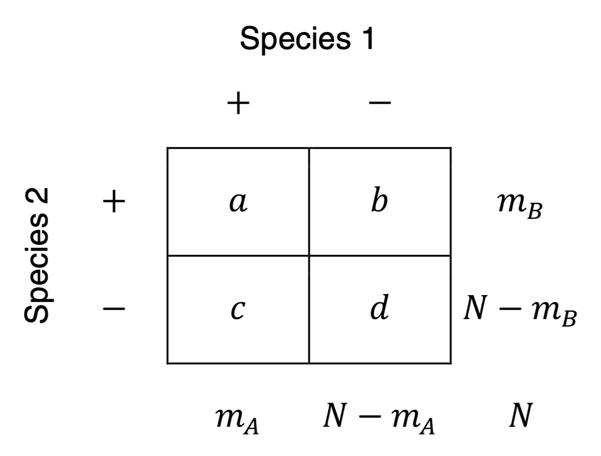
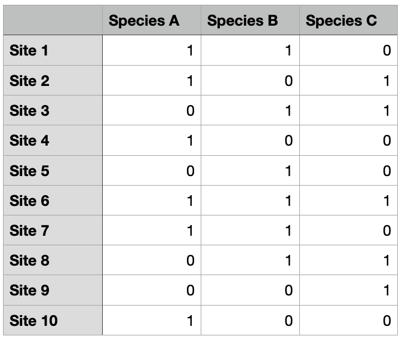
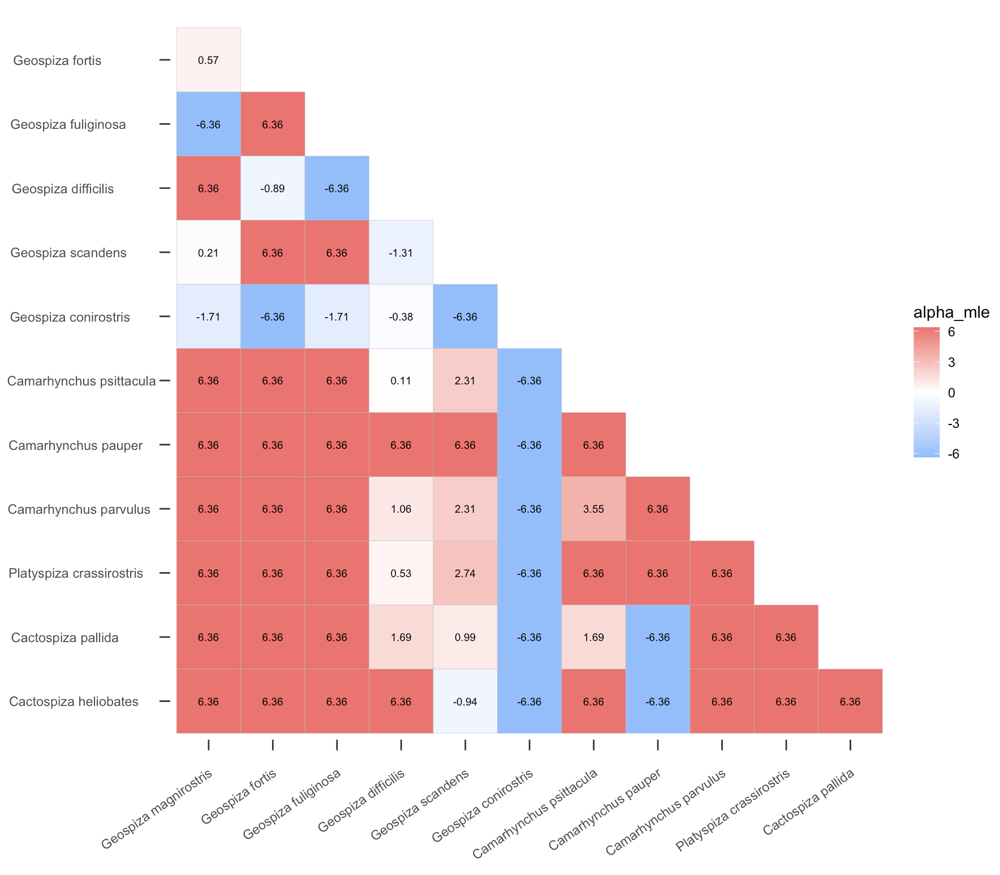
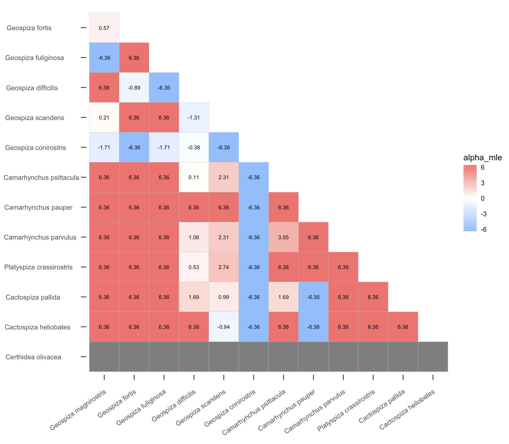
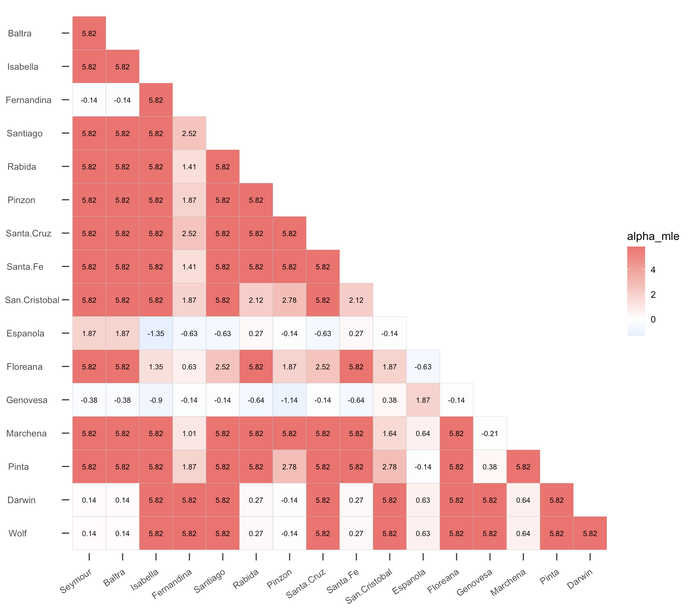
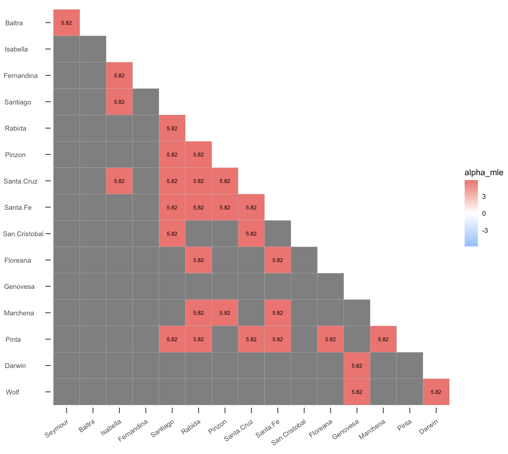
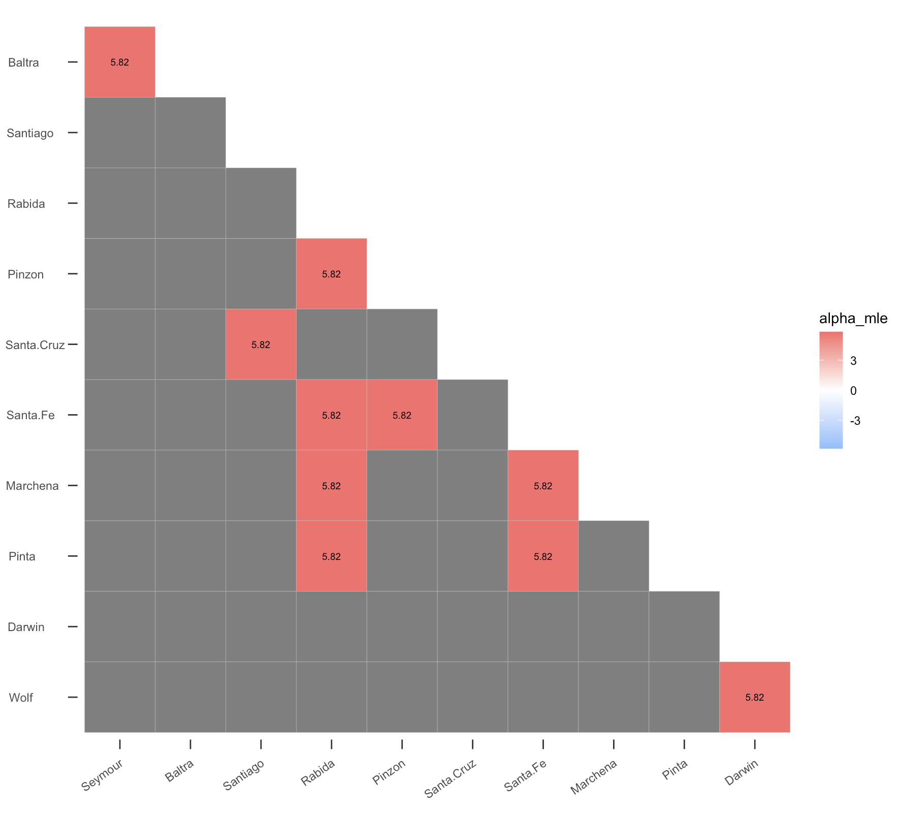

# CooccurrenceAffinity


**Short summary**

An R package for computing affinity metrics between co-occurring entities using presence/absence data. Key functions include:

- `affinity(data, row.or.col, ...)`: compute pairwise affinity statistics (MLE of alpha, expected co-occurrence, p-values, and optional square matrices) from presence/absence data
- `AlphInts(x, mA_mB_N, lev, pvalType, ...)`: calculate various confidence intervals for alpha, including conservative (Clopper–Pearson, Blaker) and mid-P methods
- `ML.Alpha(x, mA_mB_N, lev, ...)`: compute the maximum likelihood estimate of alpha and related likelihood-based metrics for co-occurrence counts
- `plotgg(data, variable, legendlimit, ...)`: create configurable ggplot2 heatmaps of affinity outputs with customizable legends, text size, and color scales


**Quick install & start**

The library can be installed from CRAN or GitHub.

```
# CRAN version
install.packages("CooccurrenceAffinity")
library(CooccurrenceAffinity)

# Load example data and compute affinity
data(finches)
res <- affinity(data = finches, row.or.col = "col")

# coverage plot illustration for a fixed (mA, mB, N)
CovrgPlot(marg = c(50,70,150), lev = 0.95)
plotgg(data = res, variable = "alpha_mle", legendlimit = "balanced")
```

> 🔎 **Scroll down for extended documentation, examples, and design notes.**

> ⬇️ **More detailed documentation and examples below**


<details>
<summary><strong>📖 Extended package description (click to expand)</strong></summary>


This package computes affinity between two entities based on their co-occurrence (using binary presence/absence data). 

The package refers to and requires an existing package called BiasedUrn, the primary functions in which calculate distributional characteristics of the Fisher Noncentral Hypergeometric distribution (pFNCHypergeo) otherwise known as Extended Hypergeometric (Harkness 1965), which is the way we refer to it in these notes.

The applications served in the present "CooccurrenceAffinity" package are primarily Ecology and other biological science data analyses in which associations of species occurrences are of interest, although the same kinds of hypothesis and estimates of statistical association among pairs of entities arise in other settings in biological and social science. (See Mainali, Slud, Singer and Fagan 2021 and Supplements for full discussion. In that paper, the connection between the scientific problems of quantifying association are related explicitly to the classic balls-in-boxes formulation underlying the hypergeometric and extended-hypergeometric distribution families.)

The statistical content of our package "CooccurrenceAffinity" is the likelihood-based (frequentist) point and interval estimation of the log-odds-ratio parameter in the Extended Hypergeometric distribution, for fixed values of the prevalence (mA, mB, respectively the total numbers of boxes containing type-A balls and type-B balls) and 2x2 table-total (N) parameters and a value (X) of the co-occurrence count, i.e. of the number of boxes containing both a type-A and a type-B ball. We call this parameter "alpha" or, interchangeably, the natural logarithm of "affinity". Its exponential, the odds or "affinity", is understood intuitively as the ratio of the odds of a site (a "box") being occupied by a type-A ball when it is already occupied by a type-B balls over the odds of type-A occupancy when no type-B ball is in that box.

## MLE and Confidence Intervals
Our primary functions ML.Alpha() and AlphInts() calculate the maximum likelihood estimate (MLE) of alpha as well as intervals (a1(x,q),a2(x,q)) of alpha values for which F(x,mA,mB,N,exp(alpha)) >= q and 1-F(x-1,mA,mB,N,exp(alpha)) >= 1-q, for specified choices of the quantile q, where F(x,mA,mB,N,exp(alpha)) denotes the Extended Hypergeometric distribution function for the co-occurance count X. The mid-point of this interval, for q=1/2, is a second reasonable statistical estimate of alpha. Furthermore, "test-based" confidence intervals for alpha are also immediately obtained from this function. For example, a two-sided 90% confidence interval would be reported either as:

    ( a1(x,0.95), a2(x,0.05) )                                         (1)

which is probably a conservative confidence interval for alpha, analogous to the Clopper-Pearson (1934) interval for binomial proportions, or

    ( (a1(x,0.95)+a2(x,0.95))/2 , (a1(x,0.05)+a2(x,0.05))/2 )          (2)

which (as we will see below) has coverage much closer to its nominal level of 90%.  All these estimates and confidence intervals are viewed as functions of the co-occurrence count x for a 2x2 table with fixed marginal counts mA, mB and table-total N. 

Two other confidence intervals for alpha are calculated in the package functions AlphaInts() and ML.Alpha(). One is another conservative confidence interval based on theoretical results of Blaker (2000) (that is, an interval whose coverage probability is probably at least as large as the nominal  confidence level) using the so-called "Acceptability Function" in that paper's Theorem 1. This confidence interval also provably lies within the first interval (1) above, so nothing is long in using it in preference to (1) except that it is somewhat less direct to explain. The last confidence interval we calculate is similar in performance to (2) defined above, but is close in spirit to the "mid-P" confidence interval defined in standard references like Agresti (2013) for the unknown probability of success in Binomial triala. This interval expressed for the Extended Hypergeometric distribution is

    ( b(x,mA,mB,N,0.95), b(x,mA,mB,N,0.05) )                            (3)
   
    where b = b(x,mA,mB,N, gamma)   solves
    (F(x,mA,mB,N,exp(b))+F(x-1,mA,mB,N,exp(b)))/2 = gamma

The test-based confidence intervals for alpha described in the previous paragraphs have more reliable moderate-sample coverage than Confidence Intervals based on a normal-distribution approximation to the MLE of alpha. This will be established in a separate small simulation study. The situation is closely related to that of confidence intervals for an unknown binomial-dstribution success probability p (Brown, Cai and DasGupta 2001). The test-based interval (a1(x,0.05), a2(x,0.95)) is analogous to the Clopper-Pearson (1934) confidence interval for the binomial p. The famous Wald interval for binomial p would correspond here to a symmetric confidence interval round the MLE based on the approximate normal distribution of the MLE of alpha. 

## Cap on MLE
It can be proved mathematically that the absolute value of the MLE for alpha never exceeds log(2*N^2) when X is not equal to either its lower or its upper possible extreme. For this reason, the interval endpoints and MLE have absolute values capped at this value in all cases. In addition, in order to avoid convergence issues in the underlying package BiasedUrn that we rely on for computation of the Extended Hypergeometric distribution function and probability mass function, the value of alpha is also restricted to the interval (-10,10) in all confidence intervals and MLE calculations.

Since exp(-10) < 1/22000, this says that our software will never report an odds ratio more extreme than that as part of a Confidence Interval. Distinguishing extremes farther out than that is probably not relevant to ecology.

## Undefined Alpha
If the mA or mB value is equal to 0 or N in the inputs to the package functions, then the corresponding co-occurrence distribution is degenerate at min(mA,mB). This means that the co-occurrence count X will always be min(mA,mB) regardless of alpha. In this case alpha is undefined, and no computations are done: an error message is returned.

## Recommendation on CI
Four confidence intervals for alpha are calculated in AlphInts() and ML.Alpha(); see Mainali and Slud (2022) for additional details. Two are conservative (CI.CP and CI.Blaker) and two (CI.midP and CI.midQ) are designed to have coverage probability generally closer to the nominal confidence level at the cost of occasional undercoverage. The CI.Blaker interval is highly recommended when a conservative interval is desired, and the CI.midP interval otherwise. However, only one p-value is computed: when pval="Blaker", the p-value is calculated according to the Blaker "Acceptability" function to be compatible with the CI.Blaker confidence interval; and otherwise the p-value is calculated to correspond to the CI.midP confidence interval. Just as it would be a statistical error to choose among the confidence intervals after calculating all of them, so it would also be an error to decide a method of p-value calculation after seeing multiple p-value types. For this reason we provide only one p-value, calculated using the same idea as one of our preferred confidence intervals according to the user's choice of the input parameter "pval".

## References

Agresti, A. (2013) Categorical Data Analysis, 3rd edition, Wiley.

Blaker, H. (2000), “Confidence curves and improved exact confidence intervals for discrete distributions”, Canadian Journal of Statistics 28, 783-798.

Brown, L., T. Cai, and A. DasGupta (2001), “Interval Estimation for a Binomial Proportion,” Statistical Science, 16, 101–117.

Clopper, C., and E. Pearson (1934), “The Use of Confidence or Fiducial Limits Illustrated in the Case of the Binomial,” Biometrika, 26, 404–413.

Harkness, W. L. (1965), Properties of the extended hypergeometric distribution. Ann. Math. Stat. 36, 938–945.

Mainali, K., Slud, E., Singer, M. and Fagan, B. (2021), “A better index for analysis of co-occurrence and similarity”, Science Advances 8, eabj9204. https://www.science.org/doi/full/10.1126/sciadv.abj9204?af=R

Mainali, K. P., & Slud, E. (2022). CooccurrenceAffinity: An R package for computing a novel metric of affinity in co-occurrence data that corrects for pervasive errors in traditional indices. BioRxiv, 2022.11.01.514801. https://doi.org/10.1101/2022.11.01.514801


## Some examples of the usage of the functions and illustrations

### 2x2 Contingency Table of Counts




If you have a co-occurrence data that is already processed and you have a table of counts like in the 2x2 contingency table above, you should begin with AlphInts() and/or ML.Alpha() for the affinity analysis. 

We compute with an example X = 35, m A = 50, m B = 70, N = 150. The syntax and results of the function calls for figuring the MLE α ˆ , the median interval, and the 90% two-sided equal-tailed confidence intervals for α, are as follows:

```

AlphInts(35,c(50,70,150), lev=0.9)    # pvalType="Blaker" by default

```


```
Loading required package: BiasedUrn 

$MedianIntrvl
[1] 1.382585 1.520007              ## median interval

$CI.CP
[1] 0.7906624 2.1474812            ## conservative Clopper-Pearson type interval

$CI.Blaker
[1] 0.8089504 2.1366923            ## conservative Blaker-type interval

$CI.midQ
[1] 0.8557288 2.0733506            ## midQ interval

$CI.midP
[1] 0.8458258 2.0844171            ## minP interval

$Null.Exp
[1] 23.33333                       ## expected X when alpha=0

$pval                              ## p-value for testing H0: alpha=0
[1] 6.081296e-05                   ## by Blaker method in this example


> ML.Alpha(35, c(50,70,150), lev=0.9)  
$est                               
[1] 1.455814                       ## Maximum Likelihood Estimate (MLE) of alpha

$LLK                               ## maximized log-likelihood for data at MLE
[1] 1.912295

$Flag                              ## indicates MLE  falls in MedianIntrvl
[1] TRUE
                                   ## later output arguments same as AlphInts()
```

### Species/Entity by Site Occupancy Table



If you have an actual occurrence dataset where your entity of interest (e.g., species) are marked as present (1) or absent (0) in sites, then you can begin with affinity(). Note that this function utilizes the outputs of AlphInts() and ML.Alpha(), and so it is important to understand the output of all three functions. 

```
# load the binary presence/absence or abundance data
data(finches)
head(finches)
```

```
                      Seymour Baltra Isabella Fernandina Santiago Rabida Pinzon
Geospiza magnirostris       0      0        1          1        1      1      1
Geospiza fortis             1      1        1          1        1      1      1
Geospiza fuliginosa         1      1        1          1        1      1      1
Geospiza difficilis         0      0        1          1        1      0      0
Geospiza scandens           1      1        1          0        1      1      1
Geospiza conirostris        0      0        0          0        0      0      0
                      Santa.Cruz Santa.Fe San.Cristobal Espanola Floreana Genovesa
Geospiza magnirostris          1        1             1        0        1        1
Geospiza fortis                1        1             1        0        1        0
Geospiza fuliginosa            1        1             1        1        1        0
Geospiza difficilis            1        0             1        0        1        1
Geospiza scandens              1        1             1        0        1        0
Geospiza conirostris           0        0             0        1        0        1
                      Marchena Pinta Darwin Wolf
Geospiza magnirostris        1     1      1    1
Geospiza fortis              1     1      0    0
Geospiza fuliginosa          1     1      0    0
Geospiza difficilis          0     1      1    1
Geospiza scandens            1     1      0    0
Geospiza conirostris         0     0      0    0

```

### Compute the affinity between elements in rows (= species)

```
myout <- affinity(data = finches, row.or.col = "row")
plotgg(data = myout, variable = "alpha_mle", legendlimit = "datarange")
```


<br><br>

On version 2.0.0, a new plotting behavior was introduced; entities whose values are entirely `NA` for the selected variable are now removed from both axes by default (`drop.empty = TRUE`). This avoids plotting empty rows or columns caused by degenerate distributions or missing data. Set `drop.empty = FALSE` to retain all entities and reproduce the legacy full-grid layout. When `sig.only` is used, `drop.empty` is applied after non-significant values are masked to NA.

```
myout <- affinity(data = finches, row.or.col = "row")
plotgg(data = myout, variable = "alpha_mle", legendlimit = "datarange", drop.empty = FALSE)
```



### Compute the affinity between elements in cols (= sites)

Using the same matrix, the affinity between islands in columns can be computed based on presence/absence of species. Set `row.or.col = "col"`.

```
myout <- affinity(data = finches, row.or.col = "col")
plotgg(data = myout, variable = "alpha_mle", legendlimit = "datarange")
```




### Display significant results only

The plot shows only the significant results with `sig.only = TRUE`.
```
myout <- affinity(data = finches, row.or.col = "col")
plotgg(data = myout, variable = "alpha_mle", legendlimit = "balanced", sig.only = TRUE)

# The same plot can be obtained with:
plotgg(data = myout, variable = "alpha_mle", legendlimit = "balanced", sig.only = 0.05)
```


<br><br>

You can change the significance level.
```
myout <- affinity(data = finches, row.or.col = "col")
plotgg(data = myout, variable = "alpha_mle", legendlimit = "balanced", sig.only = 0.01)
```



## Median Interval vs Confidence Interval

To illustrate the relative sizes of the median interval and confidence interval and their positioning with respect to MLE, we supply code to plot the point and interval estimates for X values from 1 to 49 on a single graph, in Figure 1. The graph is chopped off at α = ±5 for clarity. The maximum absolute value of log(2N^2) in this instance is 10.7. 

```
CIs = array(0, c(49,5), dimnames=list(NULL,c("MedLo","MedHi","MLE","CIlo","CIhi")))

for(x in 1:49) {
 tmp = AlphInts(x,c(50,70,150), lev=0.9)
 CIs[x,] = c(tmp$MedianIntrvl, ML.Alpha(x,c(50,70,150))$est, tmp$CI.midP)
}

plot(1:49,rep(0,49), ylim=c(-5,5), xlab="X value", ylab="alpha",
   main=paste0("MLE, Median Interval and 90% CI for alpha","\n",
               "for all X’s with mA=50, mB=70, N=150"), type="n")
for(i in 1:49) {
  segments(i,CIs[i,4],i,CIs[i,5], col="blue", lwd=2)
  segments(i,CIs[i,1],i,CIs[i,2], col="red", lwd=4) 
}
points(1:49,CIs[,3], pch=20) 
legend(10,3, legend=c("CI interval","med interval","MLE"), pch=c(NA,NA,20), lwd=c(2,4,NA), col=c("blue","red","black"))
```


</details>


